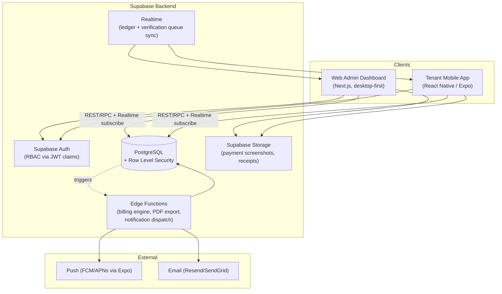
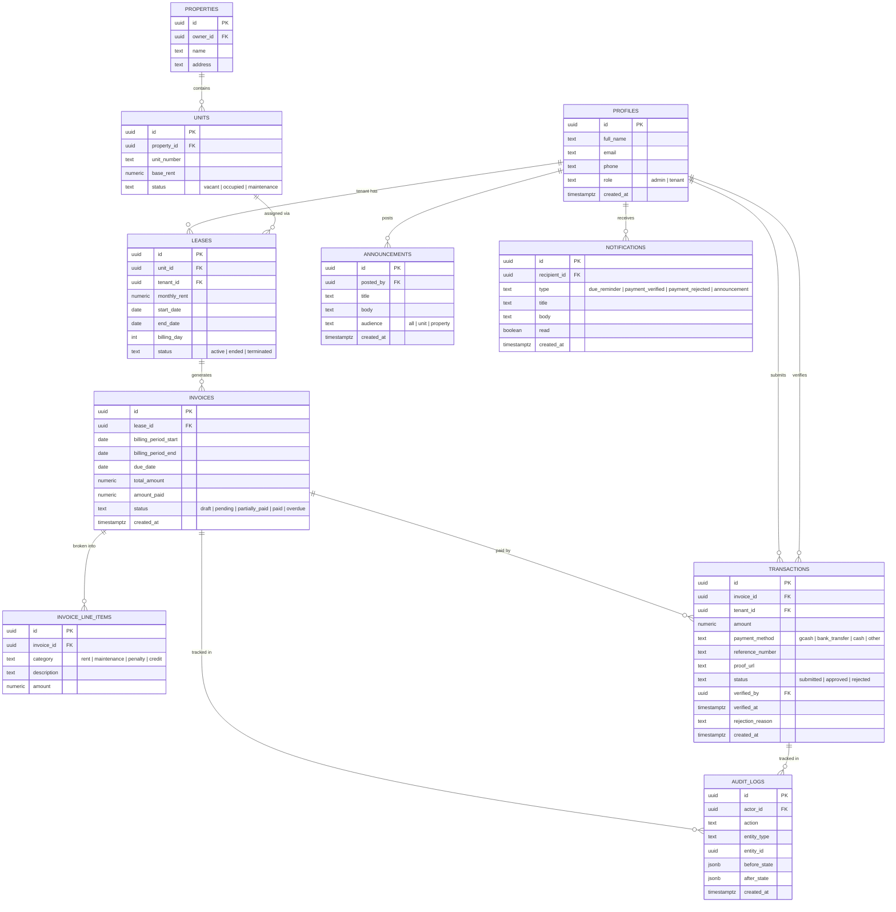

# TenantPay — System Architecture & Feature Specification

Apartment/rental payment tracking platform. Two clients (Web Admin Dashboard, Tenant Mobile App) sharing one backend and database.

---

## 1. High-Level Architecture



**Recommendation:** Supabase (managed Postgres + Auth + Storage + Realtime + Edge Functions) as the single backend for both clients. It removes the need for a hand-rolled API server, gives RBAC via Row Level Security (RLS) enforced at the database layer (not just app code), and gives both the web and mobile client a shared, typed API surface (`supabase-js`).

- **Web Admin:** Next.js (App Router) + TypeScript + Tailwind + shadcn/ui + TanStack Table + Recharts.
- **Mobile App:** React Native (Expo) + TypeScript + NativeWind + React Navigation + Expo Notifications.
- **Backend:** Supabase (Postgres, Auth, Storage, Realtime, Edge Functions in Deno/TS).
- **Shared:** a `packages/shared` workspace (types, Zod validation schemas, Supabase client wrapper, business logic like balance calculation) consumed by both apps — this is the main lever against the two frontends drifting apart.

---

## 2. Database Schema (PostgreSQL / Supabase)

### 2.1 Entity-Relationship Diagram



### 2.2 Key Design Notes

- **`profiles`** mirrors `auth.users` 1:1 (id = `auth.users.id`), holding `role` (`admin`/`tenant`) used for RBAC — never trust a role sent from the client, only what's stored server-side and injected into JWT via a custom claim or read live via RLS.
- **`invoices.amount_paid`** and `status` are derived/maintained by a Postgres trigger that recalculates on every `transactions` insert/update where `status = 'approved'` — the ledger is never hand-edited by the client, only computed server-side from approved transactions. This is the single source of truth for "Paid / Pending / Overdue" badges on both apps.
- **`transactions.status`** starts as `submitted` when a tenant uploads proof; only an `admin`-role user (enforced by RLS `WITH CHECK`) can transition it to `approved`/`rejected`. Approval is what triggers the invoice recalculation.
- **`overdue`** status is not a manually set value — a scheduled Edge Function (cron, daily) flags invoices `status = 'overdue'` when `due_date < now()` and `amount_paid < total_amount`.
- **`audit_logs`** is populated by triggers on `invoices` and `transactions` (before/after state as JSONB) — this satisfies the "Verification Queue & Audit Logs" requirement without relying on application code to remember to log.
- **Referential integrity:** `ON DELETE RESTRICT` on `leases → units`/`invoices → leases` (never silently orphan billing history); `ON DELETE CASCADE` only for strictly dependent rows (`invoice_line_items → invoices`).
- **Money as `numeric(12,2)`**, never float.

### 2.3 Row Level Security (RBAC enforcement)

```sql
-- Tenants can only see their own leases/invoices/transactions
create policy "tenant reads own invoices"
on invoices for select
using (
  lease_id in (select id from leases where tenant_id = auth.uid())
  or exists (select 1 from profiles where id = auth.uid() and role = 'admin')
);

-- Only admins can approve/reject
create policy "admin verifies transactions"
on transactions for update
using (exists (select 1 from profiles where id = auth.uid() and role = 'admin'));

-- Tenants can insert their own transaction (submit proof), not verify it
create policy "tenant submits own transaction"
on transactions for insert
with check (tenant_id = auth.uid());
```

RLS is the enforcement boundary — the app UI hiding admin buttons from tenants is UX, not security; the database must refuse the write regardless of client.

---

## 3. Web Admin Dashboard

**Stack:** Next.js 15 (App Router, Server Components for data-heavy tables) + shadcn/ui + TanStack Table + Recharts + React Hook Form + Zod.

### 3.1 Information Architecture

```
/dashboard                 → Overview & analytics
/dashboard/units           → Multi-unit table
/dashboard/units/[id]      → Unit detail (lease, tenant, history)
/dashboard/tenants         → Tenant CRUD
/dashboard/tenants/[id]    → Tenant profile, lease terms, ledger
/dashboard/billing         → Invoice generation
/dashboard/verification    → Payment verification queue
/dashboard/reports         → Exports (PDF/CSV)
/dashboard/announcements   → Push announcement composer
/dashboard/settings        → Property/org settings, admin users
```

### 3.2 Module Detail

**Multi-Unit Overview & Analytics** (`/dashboard`)
- Stat tiles: Total Collected (MTD), Outstanding Balance, Occupancy Rate, Overdue Count.
- Revenue trend chart (last 12 months, Recharts area chart) + collection-rate progress meter (collected / billed this period).
- High-density `TenantTable`: unit, tenant, monthly rent, balance, status badge (`Paid`=green, `Pending`=amber, `Overdue`=red), last payment date. Sortable/filterable, server-paginated for scale.

**Tenant & Lease Management** (`/dashboard/tenants`)
- CRUD tenant profile (invite via email → Supabase Auth magic link creates their `profiles` row with `role='tenant'`).
- Assign/reassign unit, set `monthly_rent` (overrides `units.base_rent` per lease), lease start/end, `billing_day`.
- Lease lifecycle actions: renew, terminate (cascades to unit `status='vacant'`).

**Billing** (`/dashboard/billing`)
- Utilities (electricity, water, internet) are billed directly by the providers to tenants — TenantPay never touches them, so an invoice here is just rent plus whatever the admin adds manually.
- "Generate Invoice" action (per lease or batched for everyone due this cycle): creates an `invoice` + a `rent` line item from the lease's `monthly_rent`, server-side (Edge Function), plus any manual line items (maintenance, penalty, credit).
- Bill preview before send; once generated, invoices are immutable except via a corrective credit line item (never edit history in place — keeps `audit_logs` meaningful).

**Verification Queue & Audit Logs** (`/dashboard/verification`)
- Split view: list of `submitted` transactions (left) ↔ selected transaction detail (right) showing uploaded proof image (zoomable), reference number, amount, matched invoice.
- Approve / Reject buttons (reject requires a reason, stored on `rejection_reason`, triggers a tenant notification).
- Realtime: new tenant submissions appear live via Supabase Realtime subscription, no polling.
- Audit Logs tab: filterable timeline of every invoice/transaction state change, actor, before/after diff.

**Financial Reporting** (`/dashboard/reports`)
- Date-range + property/unit filters → CSV export (raw transactions) and PDF export (formatted statement, generated server-side by an Edge Function using a headless PDF lib, not client-side jsPDF, so figures can't be tampered with before export).

---

## 4. Tenant Mobile App

**Stack:** React Native + Expo (fastest path to a real cross-platform build tenants can install; EAS Build for store deploys), NativeWind, React Navigation (bottom tabs).

### 4.1 Navigation

```
Tab: Home | Pay | History | Notifications | Profile
```

### 4.2 Screen Detail

**Home — Personal Financial Dashboard**
- Hero card: current total balance due, due date, status badge.
- Itemized breakdown (Rent / Maintenance / Penalty / Credit) pulled from `invoice_line_items` of the current open invoice. Utilities aren't included — tenants pay those providers directly.
- "Pay Now" CTA if balance > 0.

**Pay — In-App Payment & Receipt Upload**
- Select payment method (GCash / Bank Transfer / Cash — cash marked for admin manual reconciliation).
- Show landlord's GCash number / bank details (from `properties`/org settings) to pay externally, then:
  - Enter transaction reference number.
  - Upload photo/screenshot proof (camera or gallery → Supabase Storage, private bucket, signed URLs only).
  - Submit → creates `transactions` row with `status='submitted'`; invoice stays `pending` until admin approves.

**History — Transaction Ledger**
- Chronological list, each row: date, amount, method, status (`Submitted`/`Approved`/`Rejected` with reason).
- Tap → digital receipt (rendered PDF/share sheet) for `approved` transactions.

**Notifications**
- In-app feed backed by `notifications` table + push via Expo Notifications (APNs/FCM under the hood):
  - Due-date reminders (e.g., T-3 days, generated by scheduled Edge Function).
  - Payment approved/rejected.
  - Landlord announcements.

**Profile**
- Lease details (read-only), contact landlord, logout.

---

## 5. Backend & Shared Concerns

### 5.1 Business Logic That Must Live Server-Side (Edge Functions), Not in Either Client

| Function | Trigger | Why server-side |
|---|---|---|
| Invoice generation | Manual (admin) or scheduled (billing_day) | Consistent math, avoids duplicate invoices |
| Balance/status recalculation | Trigger on transaction approval | Single source of truth for both UIs |
| Overdue flagging | Daily cron | Independent of either client being open |
| Due-date reminders | Daily cron | Must fire even if tenant never opens app |
| PDF/CSV export | On demand | Figures must match DB, not re-derived client-side |

### 5.2 Authentication & RBAC

- Supabase Auth (email/password + magic link invite for tenants created by an admin).
- `role` stored in `profiles`, mirrored into a custom JWT claim via an Auth Hook so RLS policies and client route guards both read the same source.
- Web admin routes gated by middleware checking `role='admin'`; mobile app has no admin surface at all (defense in depth — even if RLS were misconfigured, the tenant app never ships admin UI/API calls).

### 5.3 File Storage

- Private Supabase Storage bucket `payment-proofs`, path-namespaced per tenant (`{tenant_id}/{transaction_id}.jpg`), RLS on storage matching the `transactions` policy — tenants can upload/read their own, admins can read all, nobody can overwrite an already-`approved` proof.

### 5.4 Notifications Delivery

- `notifications` table is the durable record (drives the in-app bell/feed on both clients).
- Edge Function fans out to Expo Push (mobile) on insert; web admin sees updates via Realtime subscription instead of push.

---

## 6. Suggested Repo Structure

```
apartment-app/
├── apps/
│   ├── web/              # Next.js admin dashboard
│   └── mobile/           # Expo tenant app
├── packages/
│   ├── shared/           # Zod schemas, TS types, balance/status calc, supabase client
│   └── config/           # eslint/tsconfig shared config
├── supabase/
│   ├── migrations/       # SQL schema, RLS policies, triggers
│   └── functions/        # Edge Functions (billing, exports, notifications, cron)
└── SPEC.md
```

Monorepo (pnpm workspaces or Turborepo) so `packages/shared` guarantees the web and mobile apps agree on invoice/status math instead of re-implementing it twice and drifting.

---

## 7. Build Phases (Suggested Order)

1. **Foundation:** Supabase project, schema + RLS migrations, auth (admin + tenant roles), monorepo scaffold.
2. **Admin core:** Tenant/lease CRUD, unit table, manual invoice creation.
3. **Tenant core:** Mobile home dashboard + payment submission flow (read-only ledger first).
4. **Verification loop:** Admin approve/reject queue + realtime + tenant status updates — this is the critical path connecting both apps.
5. **Billing automation:** Recurring invoice generation on each lease's `billing_day`, overdue cron, due-date reminders.
6. **Reporting & polish:** PDF/CSV export, announcements, push notifications, audit log UI.

---

## 8. Open Decisions for the User

- **Payment methods to support at launch** — GCash + bank transfer manual proof only, or also a payment gateway (Xendit/PayMongo) for real-time auto-verification later?
- **Multi-property support** — single property or multi-property/multi-landlord from day one? (Schema above already supports multi-property via `properties`.)
- **Mobile deploy target** — internal/TestFlight-style distribution to known tenants, or public App Store/Play listing?
